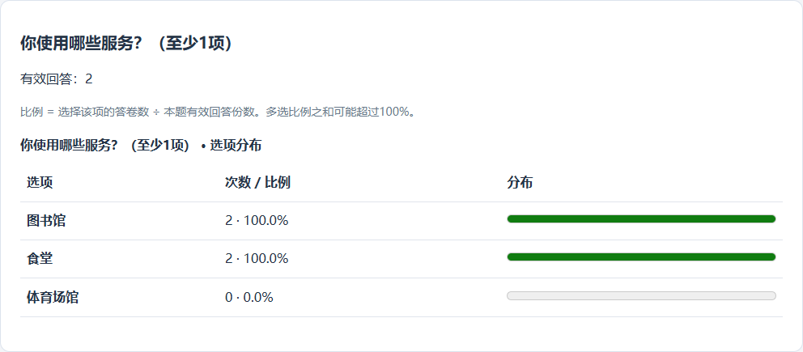

GitHub 仓库：[https://github.com/Ferrari2006/mongodb-survey-system](https://github.com/Ferrari2006/mongodb-survey-system)

# 基于 MongoDB 的问卷系统第一阶段报告

课程：数据管理系统。学号：10244304404。姓名：温正泽。修订日期：2026年10月22日。

## 项目目标与完成范围

本项目依据初始需求实现简化问卷系统，覆盖账号、问卷管理、三类题型（填空细分文本与数字）、可配置条件跳转、填写提交、匿名与重复控制以及统计。实现使用Python Flask、PyMongo和简单网页，业务数据全部存储在MongoDB，没有使用关系数据库或现成问卷系统框架。

开发优先保证数据库结构、后端规则和可验证性，前端提供完整操作入口。系统已在本地真实MongoDB上运行，31项自动化测试通过，并完成实际浏览器流程验证。当前报告对应第一阶段实现；第二阶段以该代码为基础修改。

## 系统设计及选择理由

系统按认证、问卷管理、题目校验、跳转解释与统计分成模块。将单题约束放在validation.py、将路径放在logic.py，可分别测试规则定义和填写行为；HTTP接口负责认证及数据库操作，减少规则散落在页面中的情况。

最初先建立账号与草稿流程，再补跳转、提交和统计。这样每一步都有能独立验证的结果，也便于发现界面、接口和规则之间的不一致。开发版本通过Git保留，旧草稿的兼容扩展提供显式迁移脚本。

系统的主要API如下。接口前缀为`/api`，除注册、登录和健康检查外均需登录；问卷管理与统计还检查创建者归属。完整参数、错误码及其他接口见仓库[API说明](https://github.com/Ferrari2006/mongodb-survey-system/blob/main/docs/API%E8%AF%B4%E6%98%8E.md)。

| 操作 | 方法与路径（省略`/api`） | 输入与主要结果 |
|---|---|---|
| 注册与登录 | `POST /auth/register`、`POST /auth/login` | 用户名、密码；注册返回账号标识，登录返回会话令牌 |
| 创建与发布 | `POST /surveys`、`POST /surveys/{sid}/publish` | 基本信息创建草稿；发布时提交revision并检查题目和目标 |
| 路径计算 | `POST /public/surveys/{sid}/evaluate` | answers映射；返回实际路径、下一题或完成标志 |
| 进度恢复 | `GET /public/surveys/{sid}/progress`、`PUT`同路径 | 读取本人进度；以answers、revision、request_id保存，冲突返回409 |
| 提交答卷 | `POST /public/surveys/{sid}/responses` | answers、request_id及匿名设置；保存成功201，同次重试200 |
| 查看统计 | `GET /surveys/{sid}/statistics`、`GET /surveys/{sid}/questions/{qid}/statistics` | 返回整卷或单题的计数、填写内容及数字均值 |

## MongoDB 数据库设计

核心业务集合为users、surveys和responses，sessions保存认证会话，fill_progress保存未提交的有效填写进度。题目、选项、校验配置和跳转规则嵌入问卷，因为填写和编辑通常整体读取问卷；答卷独立保存，因为其数量会随填写持续增长。此取舍同时考虑读取方式与文档增长，而非仅依据MongoDB允许嵌套。

| 集合 | 关键字段及BSON类型（节选） | 作用与关系 |
|---|---|---|
| users | `_id/username/password_hash: string`；`created_at: date` | 保存账号；其他集合通过用户ID关联，不重复保存密码 |
| sessions | `_id/user_id: string`；`expires_at: date` | `_id`保存令牌摘要，`user_id`引用账号；支持退出及过期 |
| surveys | `owner_id/title/status: string`；`questions: array`；`revision/schema_version: int`；`deadline: date/null` | 题目嵌入问卷，`owner_id`限定管理权限；版本字段分别处理编辑与结构变化 |
| fill_progress | `survey_id/user_id/request_id: string`；`answers: object`；`revision: int`；`anonymous: bool` | 按题目ID保存已确认答案；每账号每问卷一份活动进度，未提交不统计 |
| responses | `survey_id/user_id/request_id/submission_key: string`；`answers/path: array`；`anonymous: bool`；`created_at: date` | 一次成功提交一个文档；保存实际路径，支持增长、去重及聚合 |

所有集合的`_id`均为字符串。问卷内每题包含`id/title/type/required`，并按题型嵌入`options/validation/jumps`；正式答卷的`answers`为`[{question_id, value}]`，与进度中的答案映射分开处理。完整Schema及索引见仓库`database/schema.json`和`docs/数据库与系统设计.md`。

题目和选项使用稳定ID，答案引用ID而非显示文案。发布后固定题目和设置，避免同一个ID在不同时间代表不同问题。文档结构使用schema_version，编辑冲突使用revision；两个概念分开，便于后续需求变化。

账号密码以带盐哈希保存，登录令牌的摘要保存在会话集合，过期由显式时间检查和TTL清理共同处理。问卷管理查询同时包含owner_id，阻止其他账号读写。

数据库validator约束必备字段、顶层类型和状态，程序补充题目嵌套规则校验。用户名唯一索引防止重名；owner_id与updated_at索引支持列表；答卷的用户/问卷/提交标识唯一索引防止并发重复；问卷/提交时间索引支持答卷查询。

关系数据库也可以实现该系统。本项目根据指定MongoDB环境，利用文档结构描述不同题型，并按业务增长拆分答卷，没有把关系表结构机械照搬。

## 跳转设计

每题jumps数组保存操作、比较值和目标题目。单选按选项等值判断，多选支持包含任一或全部指定选项，数字支持等于及大小比较。规则按配置顺序匹配，第一条生效，未命中进入下一题。

为防止循环和无限填写，第一阶段只允许指向后续题或END。草稿编辑可先填写未来目标，发布时统一验证目标存在。这使用户能配置问卷，而不需要为每份问卷修改程序。

参考成果中的规则构建器展示方式后，编辑页补充了题型对应的条件、后续题目建议和规则上移/下移；规则显示选项文字和目标题目名称。调整顺序仍保存为同一个jumps数组，后端解释方式保持一致，减少手填ID和优先级的理解成本。

前端每次答题调用后端计算下一题；提交时后端从第一题重新计算整条路径，拒绝不应出现的答案。被跳过的必答题不要求回答。返回修改时清除后续数据并重新填写，避免旧分支答案进入统计。

## 校验与提交设计

系统检查必答、单选合法性、多选数量与重复、文本长度、数字范围及整数限制。题目定义本身也验证，例如最小值不能超过最大值。业务校验使用显式错误返回，Python assert仅用于测试。整数题定义额外检查范围内确实存在整数，避免生成无法填写的题目。

填写者先登录。匿名是对问卷创建者隐藏账号，内部保留关联以限制重复；本设计不声称匿名数据不可追溯。允许重复时每次提交独立保存，否则唯一索引保证同账号仅一份。客户端request_id使网络重试返回原结果，避免重复计数。

关闭和提交并发时，以问卷文档上的原子准入为边界：关闭前已准入的请求允许完成，关闭后新请求拒绝。独立MongoDB未使用跨集合事务，因此不承诺关闭和答卷插入的跨集合事务原子性。有效统计只读实际保存的答卷。

截止时间统一按服务器UTC比较。每次点击下一题校验成功后，将已确认答案保存到独立的fill_progress集合，刷新或同账号重新登录可恢复；当前题未确认输入不自动保存。进度使用revision防止旧窗口覆盖，返回修改清理后续答案，成功提交后清理本次进度。未提交进度不进入统计。文件未明确的这些行为已在需求文档列为实现约定，后续课堂补充可以据此调整。

## 统计设计与验证

统计以MongoDB聚合从真实responses生成：match筛选问卷，unwind展开答案，多选再展开选项；group/sum计数，avg计算数字平均值。没有选择的选项补0，无数字答案时平均值为空，空选答及被跳过题不进入单题回答数。允许重复时按答卷份数而非独立人数计算，页面明确标注。

选择题用表格与条形图同时呈现次数、比例，分母为该题有效回答份数。多选各项比例可相加超过100%，因此未使用表达互斥部分的饼图。下图为2026年10月21日实际浏览器测试截图：3份合成答卷中1份跳过该题，另外2份均选择图书馆和食堂，故两项分别为100%，而不是以整卷3份为分母的66.7%。同轮数字回答0和8，均值为4。

图：独立测试问卷的真实多选统计；原始记录见tests/results/参考借鉴优化-2026-10-21.md。

另一轮较早的独立浏览器测试于2026年10月15日完成：一份答卷跳到建议题后匿名提交，另一份经过多选与数字题后实名提交。该轮评分11被拒绝，改为8后成功；结果为总数2、有效数字回答1、平均8。此为不同测试库和轮次，不与上图的3份答卷、平均4合并。该轮还验证了页面配置跳转、发布冻结、返回修改与关闭后的拒绝，记录见仓库`tests/results/浏览器检查.md`。

31项自动化测试覆盖创建问卷、添加题目、跳转、校验、提交和统计，另含权限、过期会话、并发编辑、并发禁止重复、网络重试、空统计和旧数据迁移，以及新增的恢复进度、账号隔离、多窗口冲突、分支修改、提交清理与零值跳转。实际结果以tests/results/latest.json为准，浏览器流程不重复计入自动化数量。

以下示例对应31项自动化测试及其真实断言，最终执行日期与结果见tests/results/latest.json；报告排版核对不另计测试数量：

| 验证点与测试位置 | 典型输入 | 期望结果 | 实际验证 |
|---|---|---|---|
| 跳题与路径防伪，`test_stage1.py` | q1选a跳q3；提交q1=a、q3=18；另提交夹带q2的答案 | 合法路径为q1→q3；夹带被跳题答案不入库 | 合法提交201并保存该路径；伪造提交400，通过 |
| 数字边界，`test_validation.py` | 整数范围0～120，输入0、120、121、1.5 | 两端合法；越界及小数拒绝 | 对合法值assert相等；其余断言抛出校验错误，通过 |
| 并发与重试，`test_stage1.py` | 禁止重复时同账号4个并发请求；另以同request_id重试 | 并发仅保存1份；重试返回原答卷 | 状态码为1个201、3个409；重试200且ID相同，通过 |
| 聚合统计，`test_stage1.py` | 3份答卷：单选a/b/a，多选ab/b/a，数字10/20/空 | 单选2/1/0，多选2/2/0；数字均值15、回答数2 | 整卷断言全部一致；单题接口均值也为15，通过 |

自动化测试使用随机命名的独立MongoDB测试库，并在结束后清理。上述结果只证明已运行用例覆盖的行为，未替代压力测试或用户验收；完整步骤、输入和断言保留在`tests/`及`docs/测试说明.md`。

## AI 使用过程与问题解决

本项目使用Codex辅助开发。人工输入包括课程文件、课堂重点、提交要求和参考材料，以及后端与数据库优先、分阶段推进、保留旧版本等约束。Codex据此提出集合划分、模块和测试方案，并完成代码生成、复核修正与验证；设计和代码中的AI贡献按实际过程记录。

开发先分析需求及歧义，再实现账号与草稿、校验，最后补完整流程。曾因等待课堂补充暂缓部分规则，随后根据“先按照现有的做吧，没有的话以文件为准”的反馈，采用文档中注明的实现约定。这一反馈影响了开发顺序和业务选择。

AI生成内容经过实际验证和修正：浏览器发现题目ID正则和新建问卷残留编辑状态的问题，AI据此修复；代码复核发现选填空数组、巨大整数及整数范围不含整数的边界问题，补上校验与回归用例。结合课堂补充和参考阅读，AI识别到“每次填写保存”的解释风险，增加独立进度集合及恢复功能，并验证分支修改、匿名偏好和提交清理。测试发现器重复加载旧用例、数据库未启动时记录器再次报错，以及浏览器脚本等待与参数解析问题也已修正；最终测试数量按实际31项记录，详情和修改归属见日志。

以2026年10月16日的进度保存为例：在“这周的任务是完成第一阶段，现在开始做吧”的任务引导下，Codex复核发现“每次填写保存”的解释风险，提出将未提交进度独立保存。实现新增fill_progress及GET/PUT接口；验证覆盖刷新恢复、账号隔离、分支修改和提交清理。后续遇到终端多行参数解析失败，改为从文件加载浏览器脚本后完成验证。需求引导、AI方案、修改位置和实际结果见`ai_logs/2026-10-16-第一阶段进度完善.md`。

完整协作日志保留实际提示、代码定位、修正归属和测试结果。本报告的验证结论来自自动化及浏览器测试记录；个人操作验收结果尚未纳入该记录。

## 运行方式及后续工作

README提供依赖、MongoDB配置、迁移、启动、演示数据和测试命令。服务默认本机5050，可自行注册；运行不需要AI API Key。仓库保留代码、Schema、API、测试、报告和日志，旧实验及旧版本数据不用于本系统业务。

第一阶段的边界是简单网页、本地开发服务器和课程规模数据；未完成公网部署、生产限流、压力或多浏览器测试。填空内容当前全部返回，规模增长应分页。2026年10月22日已收到第二阶段课堂补充，涉及题目共享、版本管理及跨问卷统计等；这些扩展不计入本阶段完成范围。后续将以第一阶段代码、数据和回归测试为基线，记录设计变更与兼容处理。
