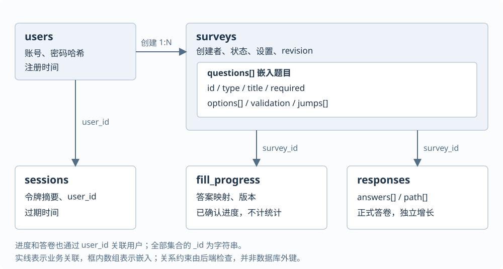

GitHub 仓库：[https://github.com/Ferrari2006/mongodb-survey-system](https://github.com/Ferrari2006/mongodb-survey-system)

# 基于 MongoDB 的问卷系统第一阶段报告

课程：数据管理系统　学号：10244304404　姓名：温正泽　修订日期：2026年10月22日

## 一、项目目标

本项目依据初始需求，实现一个简化在线问卷系统。注册用户可以创建、发布和分享问卷，其他用户登录后填写；创建者查看本人问卷及结果。第一阶段覆盖账号、问卷管理、单选、多选、文本与数字填空、条件跳转、答案校验、提交保存和统计。开发重点是MongoDB建模、后端业务逻辑及验证，网页提供相应操作入口。

系统采用Python Flask、PyMongo和原生HTML/CSS/JavaScript，账号、会话、问卷、进度及答卷均保存在MongoDB，没有使用关系数据库或现成问卷系统框架。第一阶段同时保留Schema、API、配置、测试和真实AI协作记录，作为第二阶段修改与回归验证的基础。

## 二、系统设计

### 2.1 架构与模块

浏览器通过HTTP/JSON调用Flask接口，接口完成认证和权限检查，校验与路径模块解释问卷配置，再由PyMongo读写MongoDB。跳转与答案合法性由后端判断，页面不作为可信校验边界。

| 层次或模块 | 实现 | 主要职责 |
|---|---|---|
| 前端 | 原生HTML、CSS、JavaScript | 账号入口、问卷与规则编辑、逐题填写、错误提示、统计展示 |
| HTTP服务 | Flask，`backend/app.py` | 认证、所有权、状态流转、接口及数据写入 |
| 规则模块 | `validation.py`、`logic.py` | 题目定义、答案约束、条件匹配与有效路径计算 |
| 数据层 | PyMongo、`database.py` | Schema、索引、初始化及显式旧数据迁移 |
| 统计模块 | `statistics.py` | 从正式答卷聚合次数、回答数、内容与数字均值 |

实际测试环境为Python 3.13.7、Flask 3.1.2、PyMongo 4.18.1、MongoDB 6.0.1；启动和依赖版本保留在README。模块拆分使题目约束、路径解释和接口权限可以分别验证，也便于下一阶段定位改动。

### 2.2 业务流程与边界

问卷状态为`draft → published → closed`。草稿可增删改题目和设置；发布前检查完整配置；发布后冻结题目与设置，可主动关闭或因截止时间停止接收。第一阶段需要改动已发布题目时创建新问卷，以免旧答卷被新的题目定义解释。这是本阶段的实现约定，不代表题目已要求采用特定版本模型。

创建者管理本人问卷；填写者从`/survey/{id}`登录进入，逐题校验后保存有效进度，完成后正式提交。进度不计入统计。允许匿名时，创建者看不到填写者账号；是否允许同一账号多次填写由问卷设置决定。

### 2.3 主要接口

接口前缀为`/api`。除注册、登录和健康检查外均需认证；管理、统计和答卷查看还检查问卷归属。完整参数与错误码见仓库`docs/API说明.md`。

| 操作 | 方法与路径（省略`/api`） | 输入与结果 |
|---|---|---|
| 账号 | `POST /auth/register`、`/auth/login`、`/auth/logout` | 用户名、密码；注册账号、获取或撤销会话 |
| 问卷和题目 | `POST /surveys`；`PATCH /surveys/{sid}`；`POST/PUT/DELETE`题目接口 | 基本设置、题目配置、revision；创建或修改本人草稿 |
| 发布与关闭 | `POST /surveys/{sid}/publish`、`/close` | revision；检查状态及配置后流转 |
| 校验与跳转 | `POST /surveys/{sid}/questions/{qid}/validate`；`POST /public/surveys/{sid}/evaluate` | 单题值或答案映射；返回合法性、路径和下一题 |
| 进度与提交 | `GET/PUT /public/surveys/{sid}/progress`；`POST /public/surveys/{sid}/responses` | answers、revision、request_id等；恢复进度或保存正式答卷 |
| 统计和答卷 | `GET /surveys/{sid}/statistics`、`/questions/{qid}/statistics`、`/responses` | 整卷／单题统计及分页、脱敏答卷 |

## 三、MongoDB设计

### 3.1 集合划分与关联

系统划分为5个集合。题目与问卷通常一起读取且数量有界，适合嵌入；答卷持续增长，独立存储，避免单个问卷文档不断增大。会话与未提交进度有不同的更新和过期规则，分别管理。



图1　第一阶段实际数据组织。关联使用字符串ID，由后端验证；图中的连线不是关系数据库外键。

| 集合 | 关键字段及BSON类型（节选） | 职责 |
|---|---|---|
| users | `_id/username/password_hash: string`；`created_at: date` | 账号和注册时间，密码保存带盐哈希 |
| sessions | `_id/user_id: string`；`expires_at: date` | 令牌摘要、用户关联、可撤销与过期的会话 |
| surveys | `owner_id/title/status: string`；`questions: array`；`revision/schema_version: int`；`deadline: date/null` | 问卷设置及内嵌题目，通过owner_id限定管理者 |
| fill_progress | `survey_id/user_id/request_id: string`；`answers: object`；`revision/survey_revision: int`；`anonymous: bool` | 一账号一问卷的活动进度，保存已确认答案 |
| responses | `survey_id/user_id/request_id/submission_key: string`；`answers/path: array`；`anonymous: bool`；`created_at: date` | 每次成功提交一份独立文档，保存有效路径和回答 |

所有集合的`_id`均为字符串；时间使用BSON Date。问卷题目结构节选如下，省略其他题目及问卷级字段：

```json
{
  "id": "q1", "type": "single", "title": "选择路线", "required": true,
  "options": [{"id": "a", "label": "路线A"}, {"id": "b", "label": "路线B"}],
  "validation": {},
  "jumps": [{"op": "eq", "value": "a", "target": "q3"}]
}
```

正式答卷使用`answers: [{question_id, value}]`，进度使用`answers: {题目ID: 值}`。稳定题目及选项ID用于关联，显示文字用于呈现；保存的`path`记录实际经过题目，便于检查跳题结果。

### 3.2 嵌入与引用的选择

本次复核将现有模型与其他组织方式作如下比较，说明当前选择的适用范围；该表不代表这些方案都曾实现。

| 组织方式 | 优点 | 代价及本项目选择 |
|---|---|---|
| 题目嵌入问卷，答卷独立 | 一次读取获取完整规则，答卷可持续增加 | 本阶段采用；通过发布冻结保持旧答卷语义 |
| 题目、选项全面独立集合 | 适合独立复用与更细粒度管理 | 需额外关联和一致性处理，本阶段没有该复用需求 |
| 问卷与发布快照分离 | 可支持原链接重发、保留多版内容 | 需增加版本关系与查询规则，未计入本阶段实现 |

MongoDB的文档结构便于在同一题目下保存不同题型的选项、校验参数和跳转数组。关系数据库同样可以实现问卷系统；本项目结合指定数据库及整体读取方式选择嵌入，并没有将灵活结构理解为不需要约束。

### 3.3 约束、索引与版本字段

数据库`$jsonSchema`检查必备字段、顶层类型及状态；应用检查嵌套题目、答案和跨题目标。用户名唯一索引防止重名；会话TTL索引负责清理，认证时仍显式检查会话过期，避免依赖清理时机。问卷的`owner_id + updated_at`索引用于本人列表，答卷的`survey_id + created_at`索引用于查询。

答卷设置“问卷、账号、submission_key”和“问卷、账号、request_id”两组唯一索引，分别处理重复填写策略与同次请求防重。进度以“问卷、账号”唯一，防止生成多份活动进度。完整Schema与索引见`database/schema.json`、`docs/数据库与系统设计.md`。

| 字段 | 含义与变化时机 |
|---|---|
| survey.schema_version | 文档结构版本，用于兼容与显式迁移；不是历史发布快照 |
| survey.revision | 问卷编辑／状态修订号；读到的快照、客户端预期版本和数据库条件更新须一致 |
| progress.revision | 本次填写进度版本，阻止旧窗口覆盖新进度 |
| response.survey_revision | 提交时对应的问卷修订号；发布冻结使其题目含义保持稳定 |

涉及单文档变更时使用MongoDB原子条件更新。当前本地独立MongoDB未使用跨集合事务，不能据此声称提交、清理进度等操作全部事务化；正式统计只从实际保存的答卷生成。

## 四、跳转设计

### 4.1 数据驱动的规则

每题`jumps`数组保存`op/value/target`，后端统一解释，不在程序中写某份问卷的分支。数组顺序就是优先级，第一条满足条件的规则生效；未命中进入下一题，`END`表示结束。

| 题型 | 支持的操作 | 含义 |
|---|---|---|
| 单选 | eq | 回答等于指定选项ID |
| 多选 | any / all | 包含任一／全部条件项，并非要求答案与条件数组完全相等 |
| 数字 | eq / lt / lte / gt / gte | 数值等于、小于、小于等于、大于、大于等于 |
| 文本 | 不支持条件跳转 | 校验后默认进入下一题 |

为避免循环，目标只能是后续题目或`END`。草稿可以先配置未来题目ID，发布时必须验证目标存在、方向合法、条件适用于题型。页面提供后续题目建议、选项文字以及规则上移／下移。

### 4.2 路径计算与分支修改

路径解释流程为“从首题开始 → 校验当前答案 → 按顺序匹配规则 → 进入目标或默认下一题 → 直到结束”。例如现有测试中`q1=a → q3`，q2虽为必答也被跳过；提交`q1=a、q3=18`通过，夹带q2答案则被拒绝。数字0按正常数值匹配，不作为空答案。

页面调用后端计算下一题，提交时后端从第一题重新验证整条路径，只要求实际经过题目的必答项。返回修改时清理后续答案并重新作答，避免旧分支进入进度或统计。前端隐藏题目不能替代服务端校验。

## 五、校验与提交设计

### 5.1 分层校验

题目定义阶段检查选项ID唯一、范围有序、配置适用题型；发布阶段检查整卷和跳转目标；填写阶段检查实际输入；提交阶段重新检查完整路径。业务错误使用明确的异常和HTTP响应，Python assert用于测试断言。

| 输入类型 | 校验内容 |
|---|---|
| 单选 | 必答、合法选项ID |
| 多选 | 数组、合法且不重复的选项、最少／最多选择数；两者相同表示恰好数量 |
| 文本 | 字符串、去除首尾空白后的长度、必答；单题最长5000字符 |
| 数字 | 有限数值、上下界及整数限制；整数区间必须含有合法整数 |

选填留空允许通过，非空时仍检查限制。数字采用普通JSON/BSON数值，范围限制为绝对值不超过10^15；未采用Decimal128，不承诺任意精度小数。请求上限与整卷合法答案容量一并检查，避免出现单题都合法、整卷却无法提交的情况。

### 5.2 登录、匿名与重复填写

作业要求填写者先登录，因此匿名仅向问卷创建者隐藏身份，内部仍保留用户关联用于权限和重复控制。创建者查看答卷时移除内部身份及请求字段，匿名项显示“匿名”；系统不声称数据不可追溯。

不允许重复时，同账号仅保存一份；允许重复时，每次使用新的request_id生成独立答卷。网络重试使用相同request_id返回原回执，不增加答卷数。该ID标识同一次提交，不表示对不同内容重新覆盖原答卷。

### 5.3 进度、截止与并发

点击下一题并校验成功后，将已确认答案保存到fill_progress；刷新或同账号重新登录后恢复。当前题未确认输入不自动保存。版本冲突返回409，旧窗口不能覆盖新进度；正式提交成功后清理本次进度，未提交内容不参与统计。

截止时间按服务器UTC比较。关闭与提交并发时，以问卷文档的原子准入为边界：关闭前已准入的请求允许完成，关闭后新请求拒绝。此为明确的业务边界，并非跨集合事务保证。

## 六、AI使用过程

### 6.1 AI提供的帮助

开发使用Codex。人工提供课程文件、课堂补充、提交要求和参考材料，持续强调后端与数据库优先、分阶段推进、保留旧版和真实测试。AI据此提出集合及模块方案，生成和修改前后端、Schema、测试与文档，并执行代码复核和浏览器检查。工具实际模型未逐轮核实，不推测填写。

### 6.2 实际引导与产出

| 真实任务或反馈 | 对开发的影响与产出 |
|---|---|
| “先按照现有的做吧，没有的话以文件为准” | 不继续等待无法提供的回放；依据原文实现，并将匿名、跳转优先级等列为设计约定 |
| “这周的任务是完成第一阶段，现在开始做吧” | 补齐发布、填写、提交、统计；AI复核“每次填写保存”后增加独立进度恢复 |
| “按照邵子翀的那份格式来……对比一下技术代码上的区别” | 参考章节和方案对照方式，复核交互、修订号、统计与容量边界；保留我方技术栈及第一阶段边界 |

对应完整提示、代码定位、修改与执行结果保留在`ai_logs/`，表中是实际协作摘要，不是补写的理想对话。

### 6.3 AI不足与修正

生成代码不能直接视为正确。早期实现曾将选填文本的空数组当成空值、遗漏整数区间没有整数的情况，浏览器也发现过题目ID正则及新问卷残留编辑状态。后续代码复核进一步发现切换题型、连点保存、统计失败残留及并发边界，需要结合用例修正。具体问题、处理和证据在第八节，工具层故障保留在日志，不与业务功能混淆。

### 6.4 人工参与与修改归属

人工贡献主要是明确任务优先级、提供和纠正需求来源、要求比较参考并保留历史版本，以及区分学习讲解和正式报告。具体集合字段、跳转解释器及代码修正主要由AI提出和执行，报告不将其写为学生独立编码或独立发明。已有验证来自保存的自动化和浏览器执行记录，尚未将未记录的个人操作写成已完成验收。

本次参考阅读借鉴的是报告结构、设计取舍的说明方式和验证意识。参考中的跨文档事务、发布快照、精确小数及人工验收经历没有移用为本系统成果。

## 七、测试结果

### 7.1 测试方法与证据

逻辑测试用assert检查规则和边界，API测试检查状态码、响应及真实数据库效果，浏览器测试验证页面实际操作。自动化使用随机命名的`survey_test_`独立MongoDB数据库，结束后清理，不操作旧实验或正常业务数据。

2026年10月22日14:52（北京时间）完整执行38项自动化测试，全部通过，0失败、0错误；其中包括真实MongoDB集成测试，实际数量与逐项结果保存于`tests/results/latest.json`。本轮在原31项上新增4项修订号和3项统计／容量回归，旧记录另存。浏览器流程、报告导出和静态检查不重复计入38项。

| 必需类别 | 典型输入或步骤 | 已有预期及实际验证 |
|---|---|---|
| 创建问卷 | 创建草稿，另一账号读写 | 创建201；他人列表不包含该卷，越权404 |
| 添加题目 | 添加数字题、重复ID、矛盾范围 | 合法写入；错误400且题目与修订号不变 |
| 跳转 | q1选a跳q3；夹带q2答案 | 路径q1→q3；被跳过必答不阻挡，伪造答案拒绝 |
| 校验 | 整数0～120，输入0、120、121、1.5 | 0与120通过，越界和小数拒绝 |
| 提交 | 同账号4线程、相同request_id重试 | 禁止重复时1个201、3个409；重试200且ID相同 |
| 统计 | 单选a/b/a，多选ab/b/a，数字10/20/空 | 单选2/1/0，多选2/2/0；数字回答2份、均值15 |

其他用例覆盖会话过期、匿名脱敏、并发编辑、截止与关闭、空统计、旧数据迁移、刷新恢复、账号隔离、分支清理和数字0。完整步骤、输入与断言见`tests/`及`docs/测试说明.md`。

### 7.2 统计口径与浏览器结果

正式统计由MongoDB聚合产生：match筛选问卷，unwind展开答案与多选项，group/sum计数，avg计算数值均值。未选项补0，空选答及被跳过题不进入该题回答数。允许重复时按答卷份数计算，页面明确说明。

下图来自2026年10月21日的真实浏览器检查：3份合成答卷中1份跳过多选题，另外2份都选择图书馆和食堂，因此本题分母为2，两项分别100%；数字0和8的平均值为4。


图2　多选比例之和可以超过100%，因此采用表格与条形图。原始记录见`tests/results/参考借鉴优化-2026-10-21.md`；其他日期的独立测试结果不与此轮合并。

## 八、遇到的问题与解决方法

### 8.1 已有业务问题与修正

| 问题及原因 | 实际处理 | 验证依据 |
|---|---|---|
| 错误空值类型被接受，或整数范围内没有任何整数 | 严格区分输入类型；定义时检查ceil(min)≤floor(max) | 校验及进度回归用例，含0、空数组和0.2～0.8 |
| 改答后旧分支可能残留，未提交内容与统计职责混淆 | 服务端重算路径；进度独立保存，正式提交后清理 | 路径防伪、分支修改、恢复与统计隔离测试 |
| 页面与数据状态可能不一致 | 修正新问卷残留编辑状态；显示规则优先级和选项名称 | 已保存的浏览器检查与AI修正记录 |

### 8.2 本次参考复核的优化

对照参考项目对状态、一致性和验证的说明，本次检查发现并处理以下边界：

- 编辑有跳转的选择题后改成文本，旧规则不能因为编辑区隐藏而无法移除；新建问卷保存需防连点，统计加载失败需清空旧内容，并阻止旧请求覆盖新筛选。
- 修订号既要匹配数据库条件，也必须匹配本次读取和校验的问卷快照，避免预测未来版本并发覆盖。
- 统计的回答数、选项数、内容和均值改为同一条facet聚合，使用同一批输入，避免多次查询之间新增答卷导致分母、分子不一致；不将其表述为跨请求快照事务。
- 请求限制调整为8 MiB，与100题、每题最多5000字符的合法容量相协调，同时保留超限拒绝。

修订号、统计一致性和容量回归已包含在本轮38项结果中。前端另用独立浏览器脚本检查，不重复计数；详细输入、实际输出与技术差异见`tests/results/第一阶段参考优化-2026-10-22.md`、`docs/第一阶段参考对照与优化-2026-10-22.md`。

## 九、项目总结

第一阶段围绕账号、问卷、规则、填写和统计建立了可运行系统。数据模型将有界题目配置嵌入问卷，将持续增长的答卷和频繁更新的进度分别保存；后端根据配置执行跳转、校验路径，并通过所有权、状态检查、修订号及唯一索引处理常见一致性要求。此前Lab2的CRUD与嵌套字段、Lab3的索引与聚合，在实际业务中得到应用。

项目的范围是本地开发服务器和课程规模数据，未完成公网部署、压力或多浏览器兼容验证。文本统计目前全部返回，大规模数据需要分页；进度和提交跨集合没有事务保证，数字未采用任意精度类型。第二阶段的题目共享、版本管理和跨问卷统计尚未实现，将在当前代码、数据和回归用例基础上扩展。

仓库提供可运行前后端、Schema、配置、系统与API说明、测试、AI日志和报告。应用运行不需要AI API Key。第一阶段基线标签为`stage1-baseline-20261022`，后续修改保留Git历史；最终平台提交为首放仓库链接的PDF，生成报告或推送仓库不等于完成平台提交。
