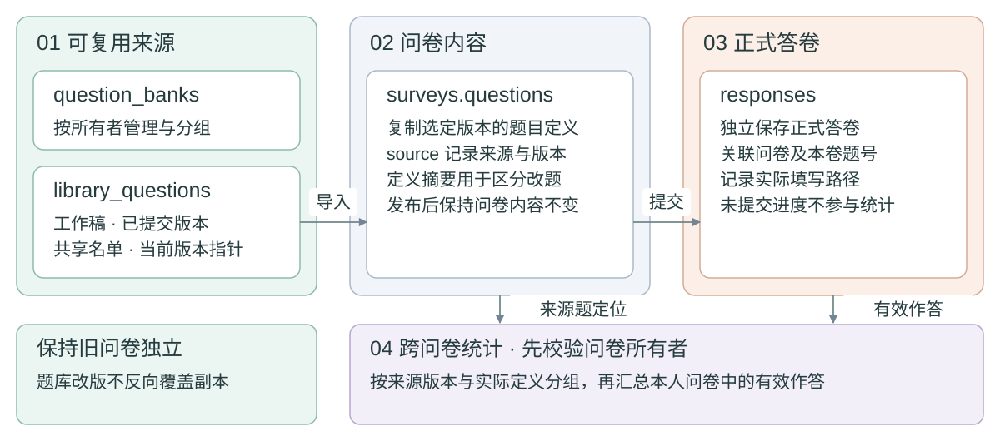
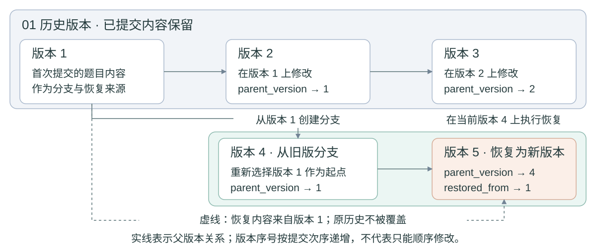

GitHub 仓库：https://github.com/Ferrari2006/mongodb-survey-system

# MongoDB问卷系统第二阶段项目报告

温正泽　10244304404　数据管理系统　2026年10月29日

## 一 需求变化与实现范围

第二阶段在原有账号、问卷、跳转、填写和统计功能上增加题目复用。常用题能够跨卷使用、共享、改版和恢复，并追踪引用与汇总答卷。问卷仍保存发布内容，另增独立的题库来源和版本历史。

本次在原Flask、PyMongo和原生网页上扩展，没有替换第一阶段技术栈。新增两个MongoDB集合及12个API，系统共有七个集合、35个API。第一阶段提交快照保留为stage1-submission-20261023，旧报告及38项测试记录保持原样。本阶段52项自动化测试通过，另完成真实浏览器流程；这些结果覆盖已执行的场景，不代表已完成大规模性能验证。

表1 第二阶段需求与处理方式

| 需求 | 实现与设计考虑 |
|---|---|
| 常用题保存与题库管理 | 支持独立建题、本人问卷题入库、题库分组及重命名，导入时明确选择版本 |
| 题目共享 | 按已有账号授予读取和使用权，接收者不能修改源题；撤销不破坏已经保存的问卷副本 |
| 保护旧问卷 | 导入时复制定义，发布后冻结；修改题库内容不反向覆盖旧问卷 |
| 历史与多版本 | 每版保存内容和父版本，允许从旧版本分支；恢复追加版本，保留恢复来源 |
| 使用追踪 | 来源字段记录题目与版本，本人查看引用位置，外部引用仅显示数量 |
| 跨问卷统计 | 按来源版本与实际定义分组；保留单卷统计，增加数字分布与文本分页 |

## 二 数据库结构与扩展理由

### 2.1 保留原有集合 增加题库来源

原五集合继续保存账户、会话、问卷、进度与正式答卷。题型、校验和跳转仍嵌入surveys.questions，随问卷一起读取；答卷独立存储，避免问卷文档随提交量持续增长。

新增question_banks保存题库名称、说明及所有者。library_questions保存题目所属题库、共享名单、工作稿、历史版本和当前版本指针。题库用于分组管理，题目用于独立共享；分享某一道题不自动开放整座题库。

表2 新增集合的主要字段

| 集合 | 主要字段 | 作用与约束 |
|---|---|---|
| question_banks | _id、owner_id、title、description、created_at | 题库归属于创建者；按所有者查询并管理 |
| library_questions | owner_id、bank_id、shared_with、working_copy、versions、current_version、revision | 题目、权限与版本同文档保存；revision用于条件更新 |
| versions内嵌条目 | id、number、parent_version、restored_from、question、created_at | 版本ID独立稳定；已提交内容不覆盖，记录分支与恢复来源 |
| surveys.questions.source | library_id、version、definition_hash | 保存导入来源及定义摘要；问卷副本不依赖实时读取题库 |

图1 题库来源与问卷快照关系

### 2.2 历史版本内嵌的取舍

版本、当前指针和修订号同文档保存，以所有者和原revision为更新条件，一次写入历史和指针。两个请求使用同一修订号时，一个成功，另一个返回409，避免覆盖修改。

内嵌历史便于整体读取和原子更新，但不能无限增长。当前每题最多保留100个已提交版本，达到上限时明确拒绝继续追加；如果后续版本量明显增加，可将历史拆成独立集合。这个限制是本项目的实现选择，不是课程指定的MongoDB结构。

新增集合使用JSON Schema约束字段类型和必需字段；索引覆盖题库所有者、题目所有者、共享名单、题库分组及问卷中的来源题ID。旧五集合的验证器不在初始化时被替换，旧问卷不要求补齐source。当前完整结构导出为database/schema-stage2.json，第一阶段schema.json保留为历史证据。

## 三 版本管理与旧数据保护

### 3.1 工作稿 提交与恢复

工作稿用于保存尚未提交为版本的修改，仅作者可见。保存工作稿不更改当前版本，其他用户和问卷只能选择已提交版本。提交时可指定任意已有版本作为父版本，因此同一来源题能够形成分支，而不是只能沿当前版本顺序覆盖。

恢复操作把选定历史内容复制为一个新版本，parent_version记录恢复操作前的当前版本，restored_from记录恢复内容来自哪一版。这样既可以恢复旧题，又不丢掉恢复前的修改过程。revision表示并发修订次数，版本ID表示题目内容历史，两者没有混用。

图2 题目版本分支与恢复

### 3.2 复制题目与记录来源

导入时复制指定版本内容，设置本卷题号并记录来源ID、版本和定义摘要。题库改版不更新副本，旧问卷继续按原题解释答卷；采用新版由创建者明确选择。

如果在草稿问卷内调整了已导入题，来源信息由服务器保留，实际题目定义重新参与统计分组。题目标题、选项、题型、必答和校验变化都按定义变化处理，避免不同含义的答案被合并。局部题号和本卷跳转不属于定义摘要；跳转只改变路径，不改变这个来源题的内容。

从问卷存入题库时，指向本卷其他题号的跳转会被移除，接口和页面明确提示。直接把这些跳转复制到另一问卷，可能产生不存在的目标或错误路径，所以导入后由创建者在目标问卷重新配置。原有后端路径计算、必答检查和发布校验继续执行。

### 3.3 共享边界

共享授予题目读取和导入权限，不授予修改原题或读取别人答卷的权限。共享对象使用已注册用户名，未知账号被拒绝；作者可以替换或清空名单。撤销后阻止新的读取和导入，已经导入的问卷副本继续可用。

题主可查本人问卷名称、题号、版本和本卷修改标识；外部引用只显示次数。跨卷统计先限制问卷所有者，再按来源查答卷，不返回他人标题、链接或答案。全局统计需另行明确授权及匿名汇总规则。

## 四 MongoDB操作与统计口径

跨卷统计沿用MongoDB聚合，由问卷中的source查找同一来源题的使用位置，再从本人问卷的正式答卷展开answers。每个回答按“来源版本ID与实际定义摘要”分组。同一题在两份问卷中各回答一次计为两次作答，分母不是去重人数；跳过题和明确空答不会生成有效答案记录。

单选和多选使用展开与分组计算各选项次数。多选每项占比除以该题有效作答次数，合计可以超过100%。数字题使用平均、最小、最大聚合，并通过$bucketAuto生成最多10个自适应区间；区间左端包含、右端不含，最后区间包含右端。不同分组的区间由各自数据生成，不能把它们当作统一年龄段直接比较。

文本题按提交时间及答卷ID排序，每页20条；总作答次数与当前页内容分开返回。数字0参与平均，空数字组返回null均值和空分布。统计使用同一个$facet输入完成分支汇总，避免为总数与选项次数分别读取带来的结果差异。选项分支只处理选择题，文本不会进入无意义的选项汇总。

表3 本次扩展实际使用的MongoDB能力

| 操作 | 用途 | 实现依据 |
|---|---|---|
| 插入与条件更新 | 创建题库、题目及版本，拒绝过期修订号 | insert_one、带revision条件的update_one |
| 嵌套字段和数组查询 | 查找来源题与共享对象、定位问卷题目 | questions.source.library_id、shared_with |
| 聚合与分桶 | 跨卷次数、平均、范围、数字分布和文本分页 | $match、$unwind、$group、$facet、$avg、$bucketAuto、$skip、$limit |
| 验证器与索引 | 约束新增数据类型，支持权限及引用查询 | backend/database.py中的Schema和新增索引 |

## 五 测试与兼容性验证

测试采用Python assert、真实MongoDB API测试和Playwright浏览器检查。自动测试创建随机survey_test_数据库，结束时清理；浏览器使用独立测试库，不清空原业务库。2026年10月28日本轮52项测试全部通过，其中原第一阶段38项保留，新增14项覆盖题库与统计；实际时间和逐项结果在tests/results/stage2-latest.json。

表4 第二阶段的主要验证

| 场景与输入 | 期望结果 | 实际结果 |
|---|---|---|
| 工作稿保存 再提交并从旧版分支恢复 | 原版本不改，父版本和恢复来源准确 | 通过 |
| 发布旧版问卷后修改题库 | 原问卷内容不变，仍可选择旧版 | 通过 |
| 两个请求携相同revision改题 | 一个200，另一个409，不丢历史 | 通过 |
| 共享双方各提交不同选项 | 每人只汇总自己的问卷和答卷 | 通过 |
| 数字答案0与8及一份空答 | 有效次数2，平均4，分桶次数合计2 | 通过 |
| 23条文本答卷分页 | 第一页20条，第二页3条，顺序稳定 | 通过 |
| 重复局部题号 未知版本与过期revision | 拒绝且问卷题目不变 | 通过 |
| 未知共享账号及撤销共享 | 非法变更不落库，撤销后不能再读取源题 | 通过 |

浏览器检查分为单账号题库流程和双账号连续验收。前者验证创建、工作稿、历史恢复、数字分布、文本翻页及390px宽度布局；后者使用两个隔离会话，通过页面完成共享、旧版本导入、发布填写、改版、撤销和恢复。接收者旧问卷保持原内容，双方分别得到自己的统计结果，题主看不到外部问卷名称。检查由Playwright执行，结果分别保存于stage2-browser.json和stage2-acceptance.json。

另从Git导出独立源码，在全新虚拟环境执行requirements.txt安装，连接空的独立MongoDB数据目录启动服务。健康检查和七集合初始化通过，随后在该环境完成52项回归与双账号验收。环境及依赖明细见tests/results/stage2-reproduction.json。兼容性通过原接口、无来源问卷、发布冻结和提交路径的回归测试验证。旧答卷不因本次初始化或题库更新被迁移覆盖。当前验证未覆盖大规模题目引用、高并发压测或全部浏览器；不能由52项通过推断这些范围也已验证。

## 六 AI使用过程与问题修正

### 6.1 分阶段引导与任务推进

本项目使用Codex辅助需求分析、数据库设计、接口实现和测试。开始时，我提供作业文档和课堂补充，明确后端逻辑、MongoDB操作和测试优先，并要求在第一阶段成果上继续开发。AI据此整理第二阶段的八项需求，把题目复用、历史关系、旧问卷保护、共享和统计转成可以核对的任务，先明确保存什么数据、允许哪些操作，再进入实现。

随后，协作围绕数据结构和业务边界展开。我的要求是保留已有功能与数据，避免第二阶段改动破坏原流程；AI比较题目复制、来源引用和版本保存方式，提出题库保留历史、问卷保存副本及来源的方案。题目和版本如何编号、恢复如何追加、共享能访问哪些内容，也在设计与接口中分别说明，而没有仅凭页面原型决定后端行为。

实现按题库与版本、共享导入、使用追踪和跨卷统计推进，之后结合原有功能做回归与浏览器验收。我持续要求检查完成范围、展示实际页面，并核对报告与仓库是否一致；AI承担具体字段设计、编码、测试脚本及执行工作。发现遗漏后再回到相应模块修改，并保存用例与结果。相关指令和产物留在ai_logs中，正文侧重说明推进方式和技术判断。

### 6.2 方案调整与验证依据

版本管理需要同时回答两个问题：修改历史能否保留，已经收集的答案是否仍按原含义解释。若问卷显示时直接读取源题，题库改版会影响旧问卷；若完全复制而不记来源，又难以查使用位置和跨卷汇总。AI据此采用“题库保留不可变版本，问卷保存独立副本和来源”的结构，通过同文档条件更新保护历史，通过内容副本保护已发布问卷。

共享的边界也需要单独检查。能够导入他人的题目，不代表可以查看其答卷。因此接口先限制问卷所有者，再处理来源题的统计；使用位置只向题主返回外部引用数。自动测试让两个账号各提交不同选项，验证彼此的统计不混入对方数据；双浏览器验收进一步检查共享、填写、改版和撤销后的连续行为。

方案落实为数据库约束、业务服务和页面交互三个层次：database.py维护Schema与索引，library.py处理权限、版本及聚合，原validation.py和logic.py继续校验题目与路径。没有把规则只放在按钮是否可点上。私有工作稿、追加恢复和定义分组属于文档未明确细节的实现约定，已在设计中说明，后续可随需求调整。

### 6.3 AI输出中发现的问题

首轮数字题跨卷统计只返回平均值，用0与8验证平均为4后便通过了测试。但正式需求以“年龄分布”为例，仅有均值无法反映分布。重新核对后，AI补充最小值、最大值和MongoDB自动分桶，并增加空组、空答和分桶次数合计测试。这一修正将检查范围从计算正确扩展到返回内容能否回答业务问题。

文本回答最初通过聚合一次收集全部内容，选项汇总分支也接收了文本回答。只在页面截取前20条，仍不能解决后端返回量的问题。AI将文本分页放入聚合分支，按时间和答卷ID稳定排序，同时限制选项分支只处理选择题。23条答卷验证了20条和3条两页的内容及顺序；该测试验证功能正确性，未用于推算大规模性能。

页面检查发现，共享接收者的编辑表单隐藏后，没有独立的题目预览。AI补上只读版本预览，使接收者能够看清内容后再导入。测试脚本也出现过将注册视为自动登录的错误，等待账号标识超时；核对应用的“注册后登录”流程后，脚本增加登录步骤再执行通过。代码和测试都需要核对，测试失败应先分清产品行为与脚本假设。

### 6.4 设计判断与使用反思

AI帮助较大的是把需求转成接口、Schema和可执行用例，但实现和测试可能共享同一遗漏。数字统计案例中，平均值断言通过，并不代表已经满足分布需求。因此验证既要回到题目逐项核对，也要用Python assert检查响应与数据库结果，再通过页面流程确认交互。业务输入错误仍用显式校验处理，不依赖可被关闭的assert。

这次协作中，我主要提供需求、安排阶段并反馈成果，AI承担大部分技术方案和实现。需要持续判断的是方案是否符合使用场景：题库改版后，旧问卷还能否解释原答案；共享题目后，双方数据是否仍然隔离；恢复旧内容后，历史记录是否仍可追踪。这些问题比页面是否出现一个按钮更能检验设计。它们也帮助我区分题目内容版本与并发修订号，理解复制、引用和条件更新分别解决什么问题。

后续仍需单独验证共享撤销与导入同时发生的竞争，并记录索引执行计划。当前52项通过只说明已覆盖用例符合预期，不能据此推断跨文档操作具备事务隔离或大规模查询性能。这也是继续使用AI时需要保留的检查方式：让方案、代码和证据相互对应，对没有验证的结论保持边界。

版本、权限与旧答卷保护的检查依据及修正记录见ai_logs中的阶段二开发和验收日志。

## 七 总结与当前限制

本阶段通过题库来源和版本历史支持复用与共享，用条件更新保护历史、内容副本保护旧问卷、定义分组保持统计口径。MongoDB嵌套查询、聚合、分桶、验证器及索引对应具体业务，并有实际测试记录。

当前每题最多100版，跨卷统计限本人问卷，数字分布自适应分桶，不提供删除引用源题的入口；扩展这些边界需先明确授权和数据量。源码、设计、API、测试及可编辑报告在同一仓库，后续可继续调整。

## 附录 页面与结果展示

以下为2026年10月29日双账号验收时的真实页面局部截图，使用独立测试库和合成账号。截图只截取相关界面区域，未改动页面文字或统计结果；同一题目分别用于创建者与接收者各自的问卷，答卷统计不因题目共享而相互开放。

图3 题库版本管理页面

页面显示当前第2版、父版本及题目预览，可选择历史版本、恢复并查看使用位置。导入按钮需从本人草稿问卷进入后使用，避免未选择目标问卷时误导入。

图4 本人问卷中的跨卷统计页面

该组来自作者问卷的一次有效回答8，均值、最小值和最大值均为8，区间[8,8]计1次。接收者另一问卷的回答2单独统计，未混入此结果；版本ID与图3相同。不同版本或本卷内容变化后的题目另分组，图中数据为验收样本，不作为实际调查结论。
