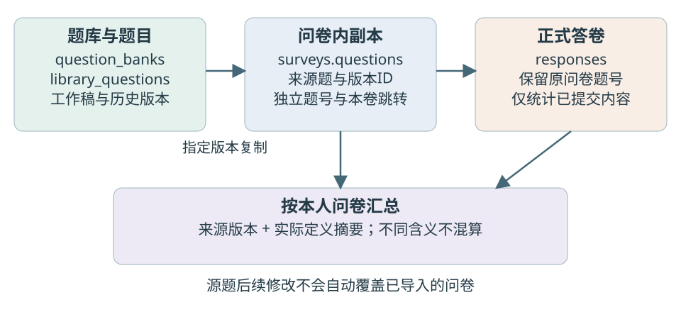
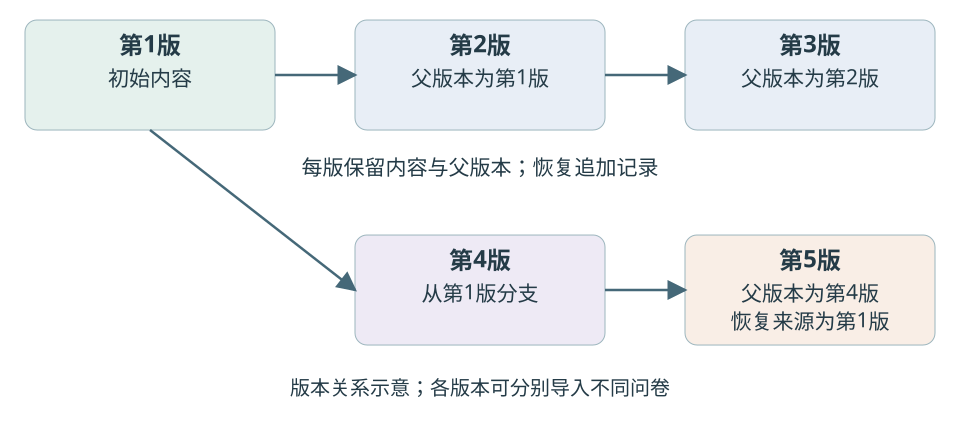

GitHub 仓库：https://github.com/Ferrari2006/mongodb-survey-system

# MongoDB问卷系统第二阶段项目报告

温正泽　10244304404　数据管理系统　2026年10月23日

## 一 需求变化与实现范围

第一阶段系统已经支持账号、问卷编辑、四类题目、条件跳转、发布、答卷提交和统计。第二阶段的变化集中在题目的复用：同一道常用题需要进入多份问卷，能够分享、改版、恢复历史，并追踪使用位置和跨问卷汇总。原来的“题目嵌入问卷”仍适合读取已发布内容，但需要增加独立的题库来源和版本记录。

本次在原Flask、PyMongo和原生网页上扩展，没有替换第一阶段技术栈。新增两个MongoDB集合及12个API，系统共有七个集合、35个API。第一阶段提交快照保留为stage1-submission-20261023，旧报告及38项测试记录保持原样。本阶段52项自动化测试通过，另完成真实浏览器流程；这些结果覆盖已执行的场景，不代表已完成大规模性能验证。

表1 第二阶段需求与处理方式

| 需求 | 实现与设计考虑 |
|---|---|
| 常用题保存与题库管理 | 支持独立建题、本人问卷题入库、题库分组及重命名，导入时明确选择版本 |
| 题目共享 | 按已有账号授予读取和使用权，接收者不能修改源题；撤销不破坏已经保存的问卷副本 |
| 保护旧问卷 | 导入时复制定义，发布后冻结；修改题库内容不反向覆盖旧问卷 |
| 历史与多版本 | 每版保存内容和父版本，允许从旧版本分支；恢复追加版本，保留恢复来源 |
| 使用追踪 | 来源字段记录题目与版本，本人查看引用位置，外部引用仅显示数量 |
| 跨问卷统计 | 按来源版本与实际定义分组；保留单卷统计，增加数字分布与文本分页 |

## 二 数据库结构与扩展理由

### 2.1 保留原有集合 增加题库来源

users、sessions、surveys、fill_progress和responses继续承担账户、会话、问卷、暂存进度与正式答卷的职责。题目仍嵌入surveys.questions，因此读取问卷时可以同时取得题型、校验和跳转规则。正式答卷不嵌入问卷，避免随提交量持续扩大问卷文档。

新增question_banks保存题库名称、说明及所有者。library_questions保存题目所属题库、共享名单、工作稿、历史版本和当前版本指针。题库用于分组管理，题目用于独立共享；分享某一道题不自动开放整座题库。

表2 新增集合的主要字段

| 集合 | 主要字段 | 作用与约束 |
|---|---|---|
| question_banks | _id、owner_id、title、description、created_at | 题库归属于创建者；按所有者查询并管理 |
| library_questions | owner_id、bank_id、shared_with、working_copy、versions、current_version、revision | 题目、权限与版本同文档保存；revision用于条件更新 |
| versions内嵌条目 | id、number、parent_version、restored_from、question、created_at | 版本ID独立稳定；已提交内容不覆盖，记录分支与恢复来源 |
| surveys.questions.source | library_id、version、definition_hash | 保存导入来源及定义摘要；问卷副本不依赖实时读取题库 |

图1 题库来源与问卷快照关系

### 2.2 历史版本内嵌的取舍

每个题目的版本、当前指针和修订号保存在同一文档，更新时以所有者和原revision作为条件，一次写入新历史和新指针。两个请求使用同一个修订号时，只允许其中一个成功，另一个返回409，避免后保存的请求覆盖前一次修改。

内嵌历史便于整体读取和原子更新，但不能无限增长。当前每题最多保留100个已提交版本，达到上限时明确拒绝继续追加；如果后续版本量明显增加，可将历史拆成独立集合。这个限制是本项目的实现选择，不是课程指定的MongoDB结构。

新增集合使用JSON Schema约束字段类型和必需字段；索引覆盖题库所有者、题目所有者、共享名单、题库分组及问卷中的来源题ID。旧五集合的验证器不在初始化时被替换，旧问卷不要求补齐source。当前完整结构导出为database/schema-stage2.json，第一阶段schema.json保留为历史证据。

## 三 版本管理与旧数据保护

### 3.1 工作稿 提交与恢复

工作稿用于保存尚未提交为版本的修改，仅作者可见。保存工作稿不更改当前版本，其他用户和问卷只能选择已提交版本。提交时可指定任意已有版本作为父版本，因此同一来源题能够形成分支，而不是只能沿当前版本顺序覆盖。

恢复操作把选定历史内容复制为一个新版本，parent_version记录恢复操作前的当前版本，restored_from记录恢复内容来自哪一版。这样既可以恢复旧题，又不丢掉恢复前的修改过程。revision表示并发修订次数，版本ID表示题目内容历史，两者没有混用。

图2 题目版本分支与恢复

### 3.2 复制题目与记录来源

问卷导入题库题时，服务器复制指定版本的题目内容，设置本问卷的局部题号，并记录来源题目ID、版本ID和定义摘要。后续题库改版不会更新这份副本，已发布问卷仍按原来的题目解释答卷。需要新版题目的问卷由创建者重新选择，系统不做隐式替换。

如果在草稿问卷内调整了已导入题，来源信息由服务器保留，实际题目定义重新参与统计分组。题目标题、选项、题型、必答和校验变化都按定义变化处理，避免不同含义的答案被合并。局部题号和本卷跳转不属于定义摘要；跳转只改变路径，不改变这个来源题的内容。

从问卷存入题库时，指向本卷其他题号的跳转会被移除，接口和页面明确提示。直接把这些跳转复制到另一问卷，可能产生不存在的目标或错误路径，所以导入后由创建者在目标问卷重新配置。原有后端路径计算、必答检查和发布校验继续执行。

### 3.3 共享边界

共享授予题目读取和导入权限，不授予修改原题或读取别人答卷的权限。共享对象使用已注册用户名，未知账号被拒绝；作者可以替换或清空名单。撤销后阻止新的读取和导入，已经导入的问卷副本继续可用。

题主可查看自己的问卷名称、局部题号、引用版本和是否发生本卷修改。其他用户的引用只显示数量，不返回其问卷标题、链接或内容。跨问卷统计先限制问卷所有者，再按来源题查找答卷。当前不提供跨所有用户的明文汇总；若后续需要全局统计，必须先明确授权和匿名汇总规则。

## 四 MongoDB操作与统计口径

跨卷统计沿用MongoDB聚合，由问卷中的source查找同一来源题的使用位置，再从本人问卷的正式答卷展开answers。每个回答按“来源版本ID与实际定义摘要”分组。同一题在两份问卷中各回答一次计为两次作答，分母不是去重人数；跳过题和明确空答不会生成有效答案记录。

单选和多选使用展开与分组计算各选项次数。多选每项占比除以该题有效作答次数，合计可以超过100%。数字题使用平均、最小、最大聚合，并通过$bucketAuto生成最多10个自适应区间；区间左端包含、右端不含，最后区间包含右端。不同分组的区间由各自数据生成，不能把它们当作统一年龄段直接比较。

文本题按提交时间及答卷ID排序，每页20条；总作答次数与当前页内容分开返回。数字0参与平均，空数字组返回null均值和空分布。统计使用同一个$facet输入完成分支汇总，避免为总数与选项次数分别读取带来的结果差异。选项分支只处理选择题，文本不会进入无意义的选项汇总。

表3 本次扩展实际使用的MongoDB能力

| 操作 | 用途 | 实现依据 |
|---|---|---|
| 插入与条件更新 | 创建题库、题目及版本，拒绝过期修订号 | insert_one、带revision条件的update_one |
| 嵌套字段和数组查询 | 查找来源题与共享对象、定位问卷题目 | questions.source.library_id、shared_with |
| 聚合与分桶 | 跨卷次数、平均、范围、数字分布和文本分页 | $match、$unwind、$group、$facet、$avg、$bucketAuto、$skip、$limit |
| 验证器与索引 | 约束新增数据类型，支持权限及引用查询 | backend/database.py中的Schema和新增索引 |

## 五 测试与兼容性验证

测试采用Python assert、真实MongoDB API测试和Playwright浏览器检查。自动测试创建随机survey_test_数据库，结束时清理；浏览器使用独立测试库，不清空原业务库。2026年10月23日本轮52项测试全部通过，其中原第一阶段38项保留，新增14项覆盖题库与统计；实际时间和逐项结果在tests/results/stage2-latest.json。

表4 第二阶段的主要验证

| 场景与输入 | 期望结果 | 实际结果 |
|---|---|---|
| 工作稿保存 再提交并从旧版分支恢复 | 原版本不改，父版本和恢复来源准确 | 通过 |
| 发布旧版问卷后修改题库 | 原问卷内容不变，仍可选择旧版 | 通过 |
| 两个请求携相同revision改题 | 一个200，另一个409，不丢历史 | 通过 |
| 共享双方各提交不同选项 | 每人只汇总自己的问卷和答卷 | 通过 |
| 数字答案0与8及一份空答 | 有效次数2，平均4，分桶次数合计2 | 通过 |
| 23条文本答卷分页 | 第一页20条，第二页3条，顺序稳定 | 通过 |
| 重复局部题号 未知版本与过期revision | 拒绝且问卷题目不变 | 通过 |
| 未知共享账号及撤销共享 | 非法变更不落库，撤销后不能再读取源题 | 通过 |

浏览器实际完成注册和登录、新建题库、新建题目、工作稿保存、提交与恢复、旧版本导入、引用位置、数字分布、文本翻页及390px宽度检查，没有页面JavaScript异常。前置答卷由测试API准备，界面按钮和显示结果由浏览器操作验证；这部分不写成我的人工点击测试。记录在tests/results/stage2-browser.json，脚本在tests/browser_library.js。

兼容性通过保留原接口、原无来源问卷、原发布冻结和提交路径的回归测试验证。旧答卷不因本次初始化或题库更新被迁移覆盖。当前验证未覆盖大规模题目引用、高并发压测或全部浏览器；不能由52项通过推断这些范围也已验证。

## 六 AI使用过程与问题修正

### 6.1 我的引导与AI承担的工作

本阶段继续使用Codex辅助实现。我提供正式需求文件和课堂补充，明确先保留第一阶段成果，再扩展题库功能；同时强调后端与数据库设计、MongoDB操作、测试和真实AI记录。第一阶段报告提交后，我又指出AI使用章节需要把具体问题、调整和验证联系起来，要求在后续补充，没有要求重写已提交PDF。

AI负责把八项需求映射到Schema、API和页面，提出工作稿、不可变版本、来源副本和统计分组的具体方案，编写代码及测试。我在记录中区分课程约束、自己的反馈与AI提出的技术决定，没有把AI完成的字段设计、编码或自动测试写成我独立完成。

### 6.2 如何把要求变成可检查的任务

对AI的约束不能只停留在“支持版本管理”。实际需要分别检查：保存工作稿会不会改旧版；恢复后历史是否还在；从旧版本分支能否说明父版本；两份问卷是否可以选择不同版本；共享后能否越权修改或查看答卷。AI按这些条件拆分接口和测试，本次结果能够对应到具体用例，而不只展示正常页面。

我的实际反馈集中在以文件为准、保留原成果、后端优先及报告过程表达。工作稿只供本人读取、恢复追加版本、跨卷统计只汇总本人问卷等细节，是AI对未明确部分提出并实现的设计约定。报告说明这些选择及限制，不将其写成老师指定，也不补写没有发生的人工取舍。

### 6.3 使用过程中遇到的AI问题

首轮数字题跨卷统计只返回平均值，测试也只验证0与8平均为4。重新核对需求中“年龄分布”的例子后，AI发现均值不能表现分布，增加范围及自动分桶，并补上空组和空答测试。这个问题说明，接口存在和测试通过还不足以证明覆盖了需求，需要回到用户场景核对返回内容是否足够。

文本统计首轮把全部回答集中返回，而且选择题汇总分支也接收了文本回答。AI在检查返回量时改为组内分页，并限制选择题分支的题型范围，避免只改页面却仍在另一聚合分支集中处理文本。23条真实答卷验证了两页数量和顺序；没有将这个小样本结果写成性能提升数据。

页面检查还发现共享用户的编辑表单被隐藏后，缺少可见的题目内容预览。AI补上独立只读预览，使接收者能先看清版本再导入。首次浏览器脚本则误把注册当作自动登录，等待账号标识超时；应用实际上提示需要登录，补上登录步骤后重跑通过。这属于测试脚本错误，不写成产品账号功能故障。

工具执行也有限制：浏览器CLI依赖下载受限，最终使用本机已有Playwright和Chrome执行普通脚本。AI保留失败原因和替代检查方式，没有把静态代码检查说成浏览器检查。真实指令、修改位置及运行结果分别记录在ai_logs/2026-10-23-stage2-start.md和stage2-review.md。

### 6.4 分工与反思

本次协作中，我负责提供要求、补充课堂信息、控制阶段顺序和指出交付表达中的不足；主要技术方案、程序修改和测试执行由AI完成。报告应让读者看见这个分工，而不是通过事后增加“我发现、我实现”的句子制造参与记录。后续仍需由我结合页面操作和关键代码理解版本、权限及统计口径，现有材料不把这项理解验收写成已经完成。

## 七 总结与当前限制

第二阶段在保留问卷快照的基础上增加题库来源和版本历史，解决了复用、共享和改题后的数据解释问题。单文档条件更新保护版本写入，复制定义保护旧问卷，按来源与实际定义分组保护统计口径。实现中继续使用MongoDB嵌套查询、数组、聚合、分桶、验证器和索引，并保留可复核的测试记录。

当前每题100个版本，跨卷统计只覆盖本人问卷，数字区间为自适应分布，没有新增删除已被引用源题的入口。这些边界用于保持历史和权限清楚，后续可在明确授权、数据量与操作需求后扩展。第二阶段报告目前为供本人核对的草稿；正式提交前应再次确认源码、测试、报告和仓库一致，并按网页要求提交PDF。
